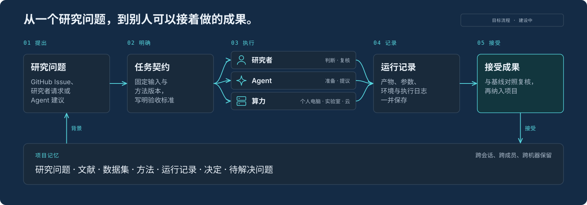
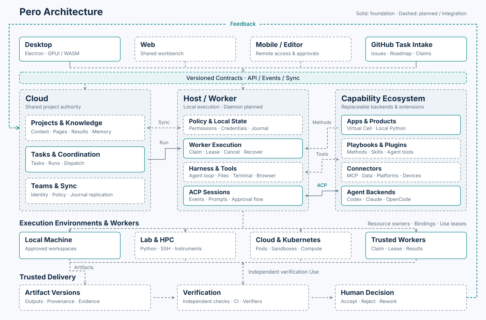

  

<h1 align="center">Pero</h1>

  <b>可组合的科研应用与分布式 Agent 协作。</b>

  <a href="https://github.com/phodal/pero/releases">下载开发版</a> ·
  <a href="ROADMAP.md">路线图</a> ·
  <a href="DEVELOPMENT.md">开发指南</a> ·
  <a href="#当前状态">当前状态</a> ·
  <a href="#参与贡献">参与贡献</a> ·
  <a href="README.md">English</a>

  

> [!NOTE]
> **开发预览。** 已提供 macOS arm64 开发版，尚无稳定发布版。

## 为什么做

科研工作流往往从脚本、Notebook 或模型 Demo 开始。Pero 将它做成 App，既可独立运行，也可放进共享工作台与其他工具一起使用。Virtual Cell 是首个实例，提供细胞图谱探索与反应模拟。

长期目标是连接这些 App、Agent、合作者与算力，让输入、方法和结果保持可追溯。

## 当前状态

| 范围 | 当前状态 | Roadmap |
| --- | --- | --- |
| Desktop 与 Agent 会话 | ACP 对话、工具结果展示、审批界面、历史和工作区已实现 | [M0](ROADMAP.md) |
| 任务与 Worker | 分派、租约、取消和恢复已实现；Linux 真实 Provider 验收待完成 | [M1](ROADMAP.md) |
| GitHub 与贡献 | 来源导入、认领和本机编码已实现；真实 GitHub PR 发布待验收 | [M2](ROADMAP.md) |
| App 与产品 | Virtual Cell 本地运行和 macOS 开发包已验证；Agent 工具和任务接线待完成 | [App 与产品](ROADMAP.md#app插件与产品) |
| 项目、知识与团队 | 项目 journal、记忆、Pages 和团队同步规划中 | [项目与团队](ROADMAP.md) |
| Playbook、插件与连接器 | 方法编排、多 Agent 团队和 MCP 接入规划中 | [方法与连接器](ROADMAP.md) |
| 可信交付 | 产物版本、独立验证和接受决定规划中 | [M3](ROADMAP.md) |
| 执行环境 | 环境模板、Use 生命周期、隔离和资源匹配规划中 | [M4](ROADMAP.md) |
| Web 与移动工作台 | 共享工作台客户端规划中；现有 Web 页面为演示或任务浏览入口 | [多端客户端](ROADMAP.md) |

## 工作方式

目标流程是：固定任务的输入与检查规则，交给合作者或获准 Worker 执行，再复核记录下来的结果。计算可以留在个人电脑、实验室服务器或云端，协调服务可以自部署。

Agent 提出建议，由人批准重要操作与最终结论。导入任务不授予执行权限，运行记录保留复核所需的证据。

实线框表示已有实现基础，虚线框和连线表示规划能力或待接通的关系。完整科研工作流仍在建设中。详情见[架构文档](docs/ARCHITECTURE.md)与[开发指南](DEVELOPMENT.md)。

## 参与贡献

提供科研场景、贡献方法或 App，或参与结果复核。从[路线图](ROADMAP.md)中选择范围明确的条目；较大的改动请先开 Issue 对齐范围与验收标准。代码改动需附可复现的检查方式。AI 辅助贡献遵循相同的审阅流程。
