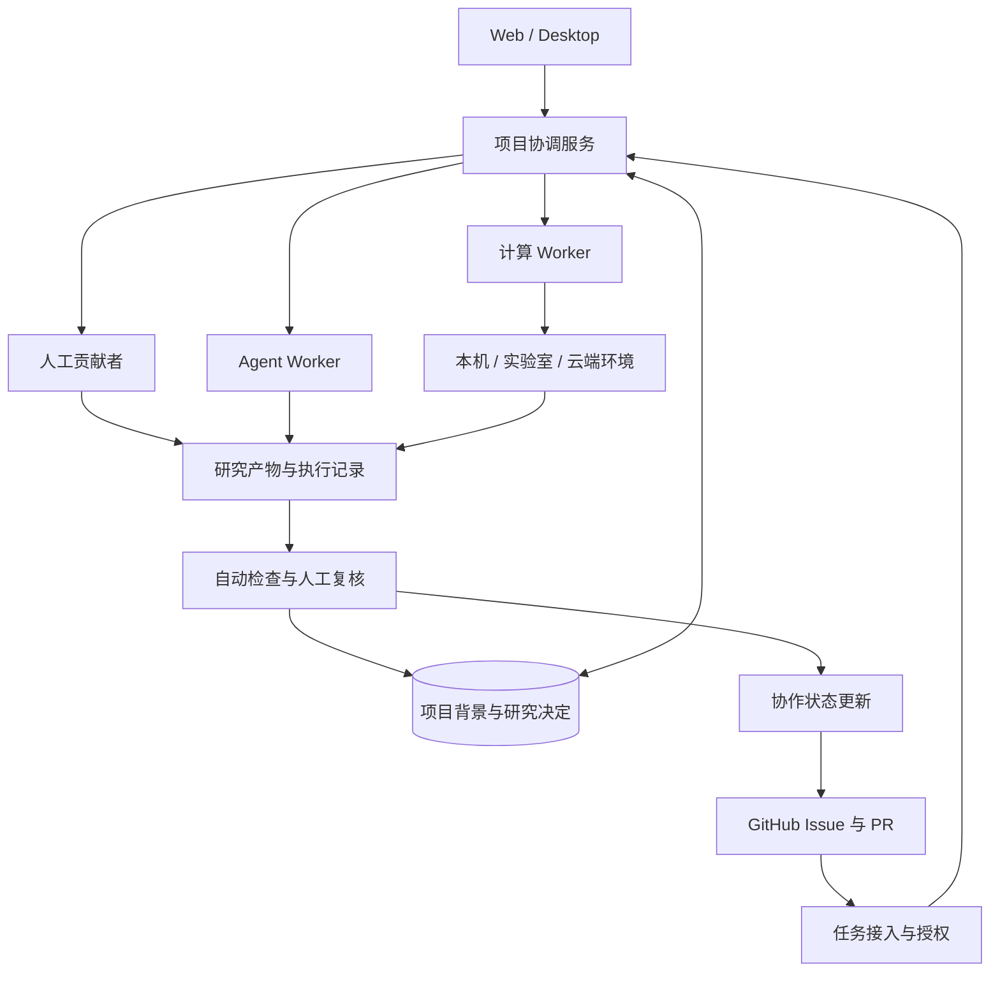

# OpenPero

**连接研究者、AI 与算力的开源科研工作台。**

把文献、数据、方法和结果放进同一个研究项目。将研究问题整理成任务，交给合作者、AI 和合适的计算环境，再把经过复核的成果带回项目。

**保留研究背景，分工完成任务，沿着已有成果继续。**

[English](README.md) · [简体中文](README.zh-CN.md) · [交互原型](docs/index.html) · [英文原型](docs/en/index.html)

> **项目处于早期阶段。** 随附原型可在浏览器中进行数值计算并导出结果。任务协调、GitHub 集成、协作者与远程执行均为模拟。下文的平台能力描述的是建设方向，不代表已经提供生产服务。

## 为什么做 OpenPero？

一个研究项目不只是一段对话。它有研究问题、参考资料、方法、已有结果、尚未解决的问题，以及下一次工作仍然需要理解的判断。

OpenPero 围绕这种连续性构建：项目，而不是聊天，是组织工作的基本单位。研究者贡献专业知识与判断，Agent 帮助准备和执行任务，Worker 把任务接到合适的工具与计算环境。

我们的目标不是替代科学判断，而是让研究更容易接着做、一起做，并且能够检查与复现。

## 我们正在构建什么

### 打开课题，接着上次的研究做

在项目中保留研究目标、论文、数据集、方法、运行记录和决定。回来时知道上次做到哪里、为什么接受某个结果，以及还有哪些问题需要解决。

### 有新变化，准备下一步

关注与课题相关的数据更新、运行完成、检查失败或新文献。说明发生了什么、哪些工作可能受影响，再提出一项具体任务。

行动应遵守项目权限与预算。改变研究方法、已接受的结论或公开结果，需要明确决定，而不是成为 Agent 执行时的附带操作。

### 把任务交给合适的人与计算环境

同一项任务可以由贡献者认领、由 Agent 处理，或由 Worker 执行。协调任务依赖、执行尝试、取消与恢复，不假设所有工作都在同一台机器上完成。

基于云的持续协调是核心架构方向，同时也应支持自部署。计算可以留在个人电脑、获准接入的实验室服务器或云端。协调服务上云，不意味着所有数据必须上云。

### 结果有来处，也有审阅记录

为结果关联输入、方法版本、参数、环境和执行记录。与已有基线比较，核对限制，再决定是否纳入项目。

**程序执行成功，不等于研究验收通过。** 过程可追溯有助于复核，但不能单独证明科学结论成立。

## 从一个 Issue，到一份可检查的研究结果

GitHub 是开放协作入口，不是整个研究执行系统。

目标流程：

1. **提出工作。** 从 GitHub Issue、研究者委托或项目变化产生的建议开始。
2. **明确任务。** 固定输入与方法版本，说明产物、资源约束和验收条件。
3. **授权与分工。** 由合作者认领，或交给获准执行的 Agent / Worker。
4. **执行与记录。** 提交研究产物，以及检查和复跑所需的执行信息。
5. **复核与接续。** 检查结果、记录决定、更新项目，并在适当时回写 GitHub。

例如，项目提出：用新数据集复跑已有方法，并解释与已审阅基线的差异。一位贡献者调整方法适配，Worker 执行比较，另一位贡献者独立复核。大家共享任务约定，不必使用同一台电脑或同一种 Agent。

并非每次内部运行都要生成 Issue。需要讨论、独立贡献或公开评审的工作，再发布到 GitHub。关闭 Issue 也不能替代研究验收记录。

## 架构方向

| 部分 | 职责 |
| --- | --- |
| **Project** | 研究目标、共享背景、已接受结果、未解决问题与决定。 |
| **Task** | 有清楚输入、产物、约束和验收条件的独立贡献单元。 |
| **Coordinator** | 依赖、授权、分配、执行状态、取消与恢复。 |
| **Worker** | 声明能力，在限定权限内执行获准的任务。 |
| **Result / Review** | 保存产物和来源，区分执行成功、验证结果与研究验收。 |
| **Web / Desktop / GitHub** | 进入、跟进、贡献与审阅同一项工作的不同入口。 |

Web / Desktop 是使用入口；本机、实验室与云端是执行位置；自部署和潜在的托管 Cloud 是部署方式。这三个决定应当分开。

协调服务在线，不代表离线的本地工具或数据仍可执行。只有存在获准、兼容的替代环境，任务才可能转交其他节点。

## 体验交互原型

下载或克隆仓库后，在浏览器中打开 [`docs/index.html`](docs/index.html)。英文页面在 [`docs/en/index.html`](docs/en/index.html)。演示无需安装依赖、注册账户、提供 API Key 或连接远程服务。GitHub 可能展示 HTML 源码；请打开下载到本机的文件进行交互。

中文文案在 `pages/src`，英文对照在 `pages/locales/en.js`。修改后运行 `node pages/scripts/build.mjs` 重新生成两个页面。色彩遵循 `DESIGN.md`。

原型包含任务准备、模拟执行位置选择、数值结果比较、复核和纳入项目的完整交互，并支持导出任务草稿、Issue 模板、JSON 记录与 CSV 数据。

| 原型内容 | 实际边界 |
| --- | --- |
| 数值计算、JSON / CSV 导出 | 在浏览器本地真实执行。 |
| 任务准备、取消、复核、验收 | 当前页面内的交互流程。 |
| GitHub 事件、Agent 建议、贡献者、远程节点 | 模拟展示，未连接外部服务。 |
| 项目持久化、真实身份协作、托管 Cloud | 本原型不提供。 |

数值示例使用合成的阻尼振子模型，对照数值解与解析参考解，不代表复现了某篇论文，也不构成真实物理实验验证。刷新页面会重置状态；离开前请导出需要保留的记录。

## 参与贡献

贡献者不必理解整个平台才能参与。我们希望每项工作都有明确范围、输入样例和验收方式。

**共同开发 OpenPero。** 贡献任务契约、协调服务、Worker 适配、连接器、验证器、界面或文档。

**共同积累科研方法。** 将可执行方法连同输入、环境要求、预期输出和检查规则一起打包；复现结果、比较方法，或独立复核他人的贡献。

**连接执行环境。** 为获准接入的本地或远程资源开发适配器。首期不以匿名开放算力网络为目标；第三方节点需要明确的信任、隔离与数据访问约束。

### 首批贡献方向

以下是建议的工作范围，不代表已经创建 Issue 或完成模块。

| 方向 | 可以独立完成的贡献 |
| --- | --- |
| 任务与结果契约 | Schema、样例数据与校验器。 |
| GitHub 连接器 | 事件身份校验、去重、任务映射与状态回写。 |
| Worker SDK | 能力注册、任务领取、心跳、取消和结果提交。 |
| 协调与故障恢复 | 任务依赖、租约、安全重试与迟到结果处理。 |
| 结果验证 | 产物检查、基线比较与独立复核接口。 |
| 科研方法包 | 固定输入、明确验证规则、可以实际运行的小型样例。 |

较大改动先通过 Issue 对齐范围、接口与验收条件。贡献应附带本地运行或测试方式。使用 AI 辅助开发的贡献，同样需要通过审阅与验证。

## 执行边界

Issue 正文、PR 和任务载荷都应视为不可信输入。提出任务，不等于获得执行权限。

执行设计需要限制凭据、资源和数据访问，并提供与任务匹配的隔离。重试必须考虑副作用，重复事件不能悄悄产生重复的高影响操作。公开结果和修改已接受的结论，应遵守项目的审阅规则。

不要把不受限制的个人电脑或实验室服务器直接连接到不可信的公共任务流。

## 路线图

| 阶段 | 要验证的结果 |
| --- | --- |
| **1. 一个可复现任务** | 固定输入、可执行方法、可检查结果与明确验收决定。 |
| **2. 一个共享项目** | 持久研究背景与任务历史，结合 GitHub 协作。 |
| **3. 两个可信 Worker** | 任务路由、取消、故障恢复与可独立复核的结果。 |
| **4. 主动式研究** | 相关变化转化为有价值的建议或规则授权的任务。 |
| **5. 方法复用与更广泛协作** | 方法包、更多执行适配器、自部署，以及托管 Cloud 的需求验证。 |

**从一个研究问题开始，让下一份贡献更容易发生。**

<!-- 维护者发布检查：确定仓库许可证并添加 LICENSE；核实源代码归属和第三方声明；随实现推进，用已验证的发布状态替换原型说明。本稿不指定许可证、不承诺托管服务，也不虚构安装命令。 -->
